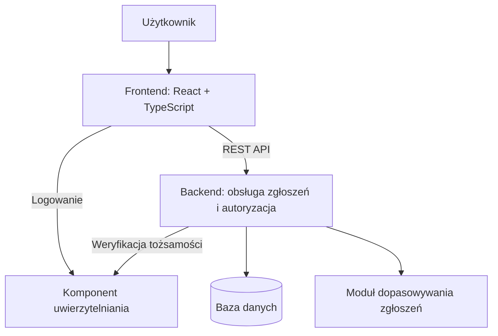

# Foundly

**Internetowy system zgłaszania, wyszukiwania i odzyskiwania zagubionych oraz znalezionych przedmiotów.**

Foundly ma połączyć osoby, które zgubiły przedmiot, z osobami, które go znalazły. Aplikacja umożliwi publikowanie zgłoszeń, przeszukiwanie ogłoszeń oraz wskazywanie potencjalnych dopasowań na podstawie cech przedmiotu, lokalizacji i daty zdarzenia.

Projekt powstaje w ramach przedmiotu **„Projekt zespołowy aplikacji internetowej”** na **Politechnice Częstochowskiej, w Katedrze Informatyki**, w roku akademickim **2026/2027**. Realizuje go trzyosobowy zespół, którego celem jest przygotowanie funkcjonalnego MVP.

> **Status: przygotowanie projektu.** Repozytorium zawiera szkielet backendu Spring Boot z konfiguracją Maven oraz katalogi frontendu i dokumentacji. Poniższy opis przedstawia planowany zakres systemu. Funkcje aplikacji i konfiguracja środowiska będą dodawane wraz z implementacją.

## Spis treści

- [Cel i sposób działania](#cel-i-sposób-działania)
- [Zakres MVP](#zakres-mvp)
- [Dalszy rozwój](#dalszy-rozwój)
- [Architektura](#architektura)
- [Technologie](#technologie)
- [Dopasowywanie zgłoszeń](#dopasowywanie-zgłoszeń)
- [Struktura repozytorium](#struktura-repozytorium)
- [Uruchomienie lokalne](#uruchomienie-lokalne)
- [REST API](#rest-api)
- [Jakość i testowanie](#jakość-i-testowanie)
- [Organizacja pracy](#organizacja-pracy)
- [Harmonogram](#harmonogram)
- [Dokumentacja](#dokumentacja)

## Cel i sposób działania

Foundly ma uprościć proces odzyskiwania przedmiotów — od dodania zgłoszenia do oznaczenia sprawy jako zakończonej.

Planowany scenariusz użytkownika:

1. Użytkownik zakłada konto i loguje się do aplikacji.
2. Dodaje zgłoszenie zagubienia lub znalezienia przedmiotu, podając jego cechy oraz miejsce i datę zdarzenia.
3. Przegląda zgłoszenia, korzysta z wyszukiwarki i filtrów.
4. Sprawdza potencjalne dopasowania wskazane przez system.
5. Zarządza własnymi zgłoszeniami, a po odzyskaniu przedmiotu aktualizuje status zgłoszenia.

## Zakres MVP

Poniższa lista określa planowany zakres pierwszej wersji aplikacji. Niezaznaczone pozycje nie są jeszcze potwierdzone jako zrealizowane.

### Konta i dostęp

- [ ] Rejestracja i logowanie użytkowników.
- [ ] Uwierzytelnianie i autoryzacja dostępu do chronionych operacji.
- [ ] Ograniczenie edycji i usuwania zgłoszeń do ich właścicieli.

### Zgłoszenia i wyszukiwanie

- [ ] Dodawanie zgłoszeń zagubionych i znalezionych przedmiotów.
- [ ] Edycja i usuwanie własnych zgłoszeń.
- [ ] Przeglądanie listy zgłoszeń i ich szczegółów.
- [ ] Wyszukiwanie i filtrowanie zgłoszeń.
- [ ] Widok „Moje zgłoszenia”.
- [ ] Zarządzanie statusem zgłoszenia, w tym oznaczanie przedmiotu jako odzyskanego.
- [ ] Podstawowy mechanizm dopasowywania zgłoszeń.

### Integracja i dostarczanie

- [ ] REST API z walidacją danych i obsługą błędów.
- [ ] Integracja frontendu z backendem.
- [ ] Specyfikacja OpenAPI i dokumentacja w Swagger UI.
- [ ] Konteneryzacja i uruchamianie środowiska przez Docker Compose.

## Dalszy rozwój

Po ukończeniu MVP zespół rozważy dodanie:

- zdjęć przedmiotów;
- powiadomień o potencjalnych dopasowaniach;
- bardziej zaawansowanego algorytmu dopasowywania;
- mapy lokalizacji;
- panelu administratora;
- zgłaszania nieodpowiednich treści.

Realizacja tych funkcji zależy od czasu pozostałego po wdrożeniu i przetestowaniu podstawowej wersji systemu.

## Architektura

Planowana architektura obejmuje aplikację webową, backend udostępniający REST API, bazę danych i osobny komponent uwierzytelniania. Moduł dopasowywania będzie częścią backendu.



Docelowo komponenty systemu będą uruchamiane w kontenerach Docker. Szczegóły integracji uwierzytelniania zostaną ustalone po wyborze rozwiązania.

## Technologie

| Obszar | Planowane technologie i narzędzia |
| --- | --- |
| Frontend | React, TypeScript, Vite, React Router, Tailwind CSS |
| Komunikacja | REST API; wybór klienta HTTP do ustalenia |
| Backend | Java 21, Spring Boot, Spring Web MVC, Spring Data JPA, Maven |
| Baza danych | PostgreSQL; sterownik dodany do backendu, połączenie i model danych do skonfigurowania |
| Uwierzytelnianie | Rozważane: Keycloak lub rozwiązanie typu Identity; ostateczny wybór do ustalenia |
| Środowisko uruchomieniowe | Docker, Docker Compose |
| Dokumentacja API | OpenAPI, Swagger UI |
| Dokumentacja kodu | Doxygen, zależnie od wybranej technologii i zakresu dokumentacji |
| Współpraca i kontrola wersji | Git, GitHub |

## Dopasowywanie zgłoszeń

Mechanizm dopasowywania ma wskazywać zgłoszenia znalezionych przedmiotów, które mogą odpowiadać zgłoszeniom zagubienia. Pierwsza wersja będzie oparta na prostych, możliwych do wyjaśnienia kryteriach.

Planowane kryteria porównania:

| Kryterium | Sposób wykorzystania |
| --- | --- |
| Typ zgłoszenia | Zestawianie zgłoszeń zagubienia ze zgłoszeniami znalezienia |
| Kategoria | Porównanie rodzaju przedmiotu |
| Nazwa i opis | Ocena podobieństwa informacji tekstowych |
| Kolor | Porównanie cech wyglądu |
| Lokalizacja | Ocena bliskości miejsc zdarzenia |
| Data | Ocena zgodności czasowej zdarzeń |

Wynik ma zawierać ocenę dopasowania i krótkie uzasadnienie, np. „ta sama kategoria, zbliżona lokalizacja i data”. Sposób obliczania oceny, wagi kryteriów oraz progi wyświetlania wyników zostaną określone podczas implementacji. Ocena ma pomagać w wyszukiwaniu i nie stanowi potwierdzenia własności przedmiotu.

## Struktura repozytorium

Przygotowany podział katalogów:

```text
.
├── frontend/              # Aplikacja webowa
│   ├── src/
│   │   ├── components/    # Komponenty interfejsu
│   │   ├── pages/         # Widoki aplikacji
│   │   ├── layouts/       # Układy stron
│   │   ├── services/      # Komunikacja z API
│   │   ├── hooks/         # Własne hooki React
│   │   ├── types/         # Typy TypeScript
│   │   └── utils/         # Funkcje pomocnicze
│   └── Dockerfile
├── foundly-backend/        # REST API i logika biznesowa; moduł Maven
│   ├── pom.xml            # Zależności i konfiguracja kompilacji Java 21
│   ├── mvnw               # Maven Wrapper dla Linux/macOS
│   ├── mvnw.cmd           # Maven Wrapper dla Windows
│   ├── .mvn/wrapper/      # Konfiguracja Maven Wrapper
│   ├── src/
│   │   ├── main/
│   │   │   ├── java/pl/szymonprofic/foundlybackend/
│   │   │   │   ├── FoundlyBackendApplication.java
│   │   │   │   ├── controllers/   # Obsługa żądań API
│   │   │   │   ├── services/      # Logika biznesowa
│   │   │   │   ├── repositories/  # Dostęp do danych
│   │   │   │   ├── models/        # Modele danych
│   │   │   │   └── matching/      # Dopasowywanie zgłoszeń
│   │   │   └── resources/
│   │   │       └── application.properties
│   │   └── test/java/pl/szymonprofic/foundlybackend/
│   │       └── FoundlyBackendApplicationTests.java
│   └── Dockerfile
├── docs/                  # Dokumentacja projektu
├── docker-compose.yml     # Konfiguracja usług lokalnych
└── README.md
```

Puste katalogi zawierają pliki `.gitkeep`, aby Git zachował strukturę repozytorium. Backend ma gotowy `Dockerfile`. Pliki `frontend/Dockerfile` i `docker-compose.yml` są na razie puste i wymagają uzupełnienia podczas implementacji.

### Moduł backendu i import w IntelliJ IDEA

Backend jest jednym modułem Maven, opisanym przez `foundly-backend/pom.xml`. Katalogi `controllers`, `services`, `repositories`, `models` i `matching` są pakietami Javy wewnątrz tego modułu. Klasy należy umieszczać pod pakietem `pl.szymonprofic.foundlybackend`, aby znajdowały się w obszarze skanowania klasy startowej Spring Boot.

Główny katalog repozytorium jest zwykłym folderem projektu, bez własnego modułu IntelliJ. Jedynym modułem jest `foundly-backend`. Frontend jest osobną aplikacją React i nie wymaga modułu Javy. Na tym etapie nie są potrzebne nadrzędny `pom.xml` ani plik `module-info.java`.

1. Otwórz główny katalog repozytorium w IntelliJ IDEA.
2. Jeśli backend nie jest jeszcze widoczny w oknie Maven, kliknij prawym przyciskiem `foundly-backend/pom.xml` i wybierz **Add as Maven Project**.
3. Ustaw SDK projektu i JDK dla Maven na **Java 21**.
4. Po synchronizacji Maven IDE powinno oznaczyć `src/main/java` jako źródła, `src/test/java` jako testy, a `src/main/resources` jako zasoby.

Konfiguracja `.idea/` oraz pliki `*.iml` są lokalne i pomijane przez Git. Źródłem konfiguracji backendu dla zespołu jest `pom.xml`.

## Uruchomienie lokalne

Szczegółowe instrukcje budowania, uruchamiania, testowania i obsługi kontenera znajdują się w [devops.md](docs/devops.md).

Backend można uruchomić lokalnie lub w kontenerze z bazą H2 w pamięci, bez instalowania PostgreSQL. Dostępny jest endpoint testowy `GET /api/v1/test`. Frontend jest szkieletem katalogów, a pliki `frontend/Dockerfile` i `docker-compose.yml` są puste.

Repozytorium można pobrać poleceniami:

```bash
git clone https://github.com/SzymonProfic/Projekt-zespolowy-aplikacji-internetowej.git
cd Projekt-zespolowy-aplikacji-internetowej
```

Do kompilacji backendu potrzebny jest JDK 21 oraz poprawnie ustawione `JAVA_HOME`. Maven Wrapper pobiera wersję Maven wskazaną w `.mvn/wrapper/maven-wrapper.properties`, więc osobna instalacja Maven nie jest wymagana.

Uruchomienie backendu:

```bash
cd foundly-backend
./mvnw spring-boot:run
```

W Windows użyj `mvnw.cmd spring-boot:run`. Testy uruchomisz poleceniem `./mvnw test`.

- Endpoint testowy: http://localhost:8080/api/v1/test (zwraca `test`).
- Konsola H2: http://localhost:8080/h2-console.
- Dane logowania do konsoli: JDBC URL `jdbc:h2:mem:foundly`, użytkownik `sa`, hasło puste.

Baza H2 służy do pracy lokalnej. Dane są usuwane po zatrzymaniu aplikacji. Docelowe połączenie z PostgreSQL będzie wymagało osobnej konfiguracji.

### Backend w Dockerze

Z głównego katalogu repozytorium wykonaj:

```bash
docker build -t foundly-backend ./foundly-backend
docker run --rm --name foundly-backend -p 8080:8080 foundly-backend
```

Wymagany jest uruchomiony Docker; lokalna instalacja Javy i Maven nie jest potrzebna. Obraz jest budowany w dwóch etapach: Maven Wrapper kompiluje aplikację i uruchamia testy na JDK 21, a końcowy obraz zawiera JRE 21 i plik JAR. Aplikacja działa jako użytkownik bez uprawnień roota.

Endpoint testowy jest dostępny pod adresem http://localhost:8080/api/v1/test. Kontener korzysta z opisanej wyżej bazy H2 w pamięci. Zatrzymasz go poleceniem `docker stop foundly-backend` w drugim terminalu.

### Całe środowisko (planowane)

Po przygotowaniu konfiguracji kontenerów docelowe uruchomienie całego środowiska będzie wymagało zainstalowanego Dockera z Docker Compose i polecenia:

```bash
docker compose up --build
```

Powyższe polecenie będzie dostępne dopiero po uzupełnieniu plików Dockera i dodaniu kodu aplikacji. Wraz z implementacją ta sekcja zostanie uzupełniona o wymagane wersje narzędzi, zmienne środowiskowe, inicjalizację bazy danych, adres aplikacji, API i Swagger UI oraz konfigurację usługi uwierzytelniania.

## REST API

Backend będzie udostępniał REST API. Poniższe endpointy są propozycją kontraktu i mogą zmienić się podczas projektowania systemu.

| Metoda | Ścieżka | Przeznaczenie |
| --- | --- | --- |
| `GET` | `/api/reports` | Pobranie listy zgłoszeń z wyszukiwaniem i filtrowaniem |
| `GET` | `/api/reports/{id}` | Pobranie szczegółów zgłoszenia |
| `POST` | `/api/reports` | Utworzenie zgłoszenia |
| `PUT` | `/api/reports/{id}` | Aktualizacja własnego zgłoszenia |
| `DELETE` | `/api/reports/{id}` | Usunięcie własnego zgłoszenia |
| `GET` | `/api/matches` | Pobranie potencjalnych dopasowań |
| `GET` | `/api/matches/{id}` | Pobranie szczegółów dopasowania |

Przebieg logowania i endpointy związane z uwierzytelnianiem zostaną ustalone po wyborze jego dostawcy. Schematy danych, parametry zapytań, kody odpowiedzi i zasady dostępu będą opisane w specyfikacji OpenAPI.

## Jakość i testowanie

System ma zapewniać responsywny interfejs działający w popularnych przeglądarkach, walidację danych wejściowych, czytelną obsługę błędów oraz kontrolę dostępu do operacji na zgłoszeniach. Modularna architektura ma ułatwić dalszą rozbudowę aplikacji.

Planowany zakres testów obejmuje:

- operacje CRUD i zmiany statusów zgłoszeń;
- walidację poprawnych i niepoprawnych danych;
- uwierzytelnianie i uprawnienia do zarządzania własnymi zgłoszeniami;
- wyszukiwanie i filtrowanie;
- poprawność wyników dopasowywania;
- integrację frontendu, backendu i usługi uwierzytelniania;
- podstawowe scenariusze użytkownika, od dodania zgłoszenia do oznaczenia przedmiotu jako odzyskanego.

Narzędzia i polecenia uruchamiające testy zostaną dodane po skonfigurowaniu poszczególnych części aplikacji.

## Organizacja pracy

Wstępny podział odpowiedzialności w trzyosobowym zespole:

| Rola | Zakres odpowiedzialności |
| --- | --- |
| Osoba 1 | Backend, REST API, CRUD, baza danych |
| Osoba 2 | Frontend, React i TypeScript, UI/UX |
| Osoba 3 | Dopasowywanie zgłoszeń, uwierzytelnianie, DevOps i integracja |

Podział może być dostosowywany do bieżących potrzeb projektu. Priorytetem pozostaje ukończenie i integracja funkcji MVP. W przypadku opóźnień funkcje dodatkowe zostaną odłożone, aby zachować czas na testy, konteneryzację i dokumentację.

## Harmonogram

Plan realizacji na rok akademicki 2026/2027. Daty określają planowane etapy i nie potwierdzają ich ukończenia.

| Termin | Planowany zakres |
| --- | --- |
| 07.10.2026 | Ustalenie zakresu, wymagań, podziału zadań i repozytorium |
| 14.10.2026 | Architektura, model danych, projekt REST API i interfejsu |
| 21.10.2026 | Backend, baza danych i podstawy frontendu |
| 28.10.2026 | Operacje CRUD i podstawowe widoki |
| 04.11.2026 | Rozbudowa API i formularze |
| 18.11.2026 | Uwierzytelnianie i autoryzacja |
| 25.11.2026 | Moduł dopasowywania zgłoszeń |
| 02.12.2026 | Integracja dopasowywania z frontendem |
| 09.12.2026 | Integracja frontendu z backendem |
| 16.12.2026 | Widok „Moje zgłoszenia”, statusy i dopracowanie UX |
| 30.12.2026 | Testy i poprawki |
| 06.01.2027 | Konteneryzacja |
| 13.01.2027 | Dokumentacja i przygotowanie prezentacji |
| 20.01.2027 | Prezentacja i oddanie projektu |
| 27.01.2027 | Końcowe zaliczenie |

## Dokumentacja

W ramach projektu planowane są:

- **dokumentacja techniczna** — architektura, model danych i opis modułów;
- **dokumentacja API** — specyfikacja OpenAPI i Swagger UI;
- **dokumentacja użytkowa** — najważniejsze scenariusze korzystania z aplikacji;
- **dokumentacja wdrożeniowa** — konfiguracja środowiska i uruchamianie usług;
- **dokumentacja kodu** — z wykorzystaniem Doxygen w uzgodnionym zakresie.

Materiały będą dodawane do katalogu `docs/` wraz z postępem prac.
