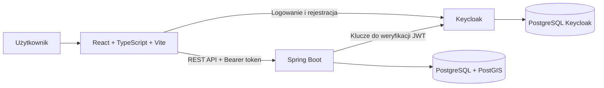

# Foundly

**Internetowy system zgłaszania, wyszukiwania i odzyskiwania zagubionych oraz znalezionych przedmiotów.**

Foundly pozwala publikować zgłoszenia zagubienia i znalezienia przedmiotów, przeglądać ogłoszenia oraz zarządzać własnymi zgłoszeniami. Frontend korzysta z REST API; dane są przechowywane w PostgreSQL z PostGIS, a rejestrację i logowanie obsługuje Keycloak.

Projekt powstaje w ramach przedmiotu **„Projekt zespołowy aplikacji internetowej”** na **Politechnice Częstochowskiej, w Katedrze Informatyki**, w roku akademickim **2026/2027**. Realizuje go trzyosobowy zespół.

## Aktualny zakres

W kodzie opartym na `main` działają:

- rejestracja, logowanie i wylogowanie przez Keycloak oraz synchronizacja profilu użytkownika;
- publiczna lista ogłoszeń i widok szczegółów, pobierane wyłącznie z API;
- dodawanie zgłoszeń typu `lost` i `found` oraz edycja aktywnych zgłoszeń przez autora;
- widok „Moje ogłoszenia” z filtrami i paginacją;
- kończenie i trwałe usuwanie własnych zgłoszeń z potwierdzeniem w interfejsie;
- filtrowanie listy po typie, statusie, kategorii i obszarze na mapie;
- podpowiedzi polskich miast i wybór miejsca zdarzenia na mapie Leaflet;
- walidacja danych, kontrola właściciela i wykrywanie konfliktów wersji;
- dokumentacja OpenAPI i Swagger UI;
- uruchamianie bazy, Keycloak i backendu przez Docker Compose.

Zgłoszenie ma status `ACTIVE` lub `RESOLVED`. Dostępne przejście to `ACTIVE → RESOLVED`; zakończonego zgłoszenia nie można edytować ani ponownie otworzyć. Autor może usunąć zarówno aktywne, jak i zakończone zgłoszenie. `ALL` jest opcją filtrowania, a `lost` i `found` określają typ zgłoszenia.

API obsługuje także zapytanie tekstowe `q`, filtr nazwy miejsca i zakres dat zdarzenia. Obecny formularz filtrów frontendu nie udostępnia tych parametrów. `q` wyszukuje fragment tytułu lub opisu bez rozróżniania wielkości liter; nie jest wyszukiwaniem semantycznym ani rankingiem trafności.

### Gałąź experimental

`experimental` dodatkowo zawiera usługę embeddingów, rozszerzenie pgvector, kolejkę zadań i automatyczne dopasowywanie LOST/FOUND z rankingiem oraz endpointem odczytu dopasowań dla autora. Te zmiany nie są jeszcze scalone do `main`. Ich konfiguracja i testy są opisane w dokumentacji dostępnej po przełączeniu na tę gałąź. Instrukcje poniżej dotyczą wariantu z `main`.

Zdjęcia, powiadomienia, widok automatycznych dopasowań na froncie, panel administratora i moderacja pozostają kierunkami dalszego rozwoju.

## Architektura i technologie



| Obszar | Używane rozwiązania |
| --- | --- |
| Frontend | React, TypeScript, Vite, React Router, CSS, Lucide |
| Mapy | Leaflet z podkładem OpenStreetMap, lokalny wykaz polskich miast |
| Komunikacja | `fetch`, wspólny klient HTTP i adapter autoryzacji w `frontend/src/services/` |
| Backend | Java 21, Spring Boot, Spring Web MVC, Spring Data JPA, Maven Wrapper |
| Dane | PostgreSQL, PostGIS, migracje Flyway |
| Uwierzytelnianie | Keycloak, Authorization Code z PKCE S256, walidacja JWT w Spring Security |
| Testy | Vitest, Node.js test runner, JUnit, Spring Boot Test, Testcontainers |
| Kontenery | Docker, Docker Compose; frontend ma osobny Dockerfile z Nginx |
| Kontrakt API | OpenAPI i Swagger UI |

Tokeny są przechowywane w pamięci adaptera Keycloak. Komponenty frontendu korzystają z serwisów domenowych; wspólny klient obsługuje JSON i błędy HTTP, a adapter autoryzacji pobiera aktualny token przed chronionymi operacjami.

## Uruchomienie lokalne

Wymagania dla poniższego wariantu: Docker z Docker Compose oraz Node.js **22.12+ z gałęzi 22 lub 24+** i npm. JDK 21 jest potrzebny do lokalnego uruchamiania i testowania backendu, ale backend kontenerowy buduje się bez lokalnej instalacji Javy.

### Baza, Keycloak i backend

Z głównego katalogu repozytorium:

```bash
cp .env.example .env
```

Jeśli `.env` już istnieje, zachowaj jego ustawienia. Ustaw lokalne hasła i uruchom:

```bash
docker compose --profile app up -d --build
```

Compose uruchamia PostGIS, osobną bazę Keycloak, Keycloak, inicjalizację realmu i kont demonstracyjnych oraz backend. Dane baz pozostają w wolumenach. Usługa `keycloak-init` jest jednorazowym zadaniem; po poprawnym zakończeniu ma status `Exited (0)`.

Podgląd stanu i logów:

```bash
docker compose ps -a
docker compose logs -f backend keycloak-init
```

### Frontend

W osobnym terminalu:

```bash
cd frontend
npm ci
npm run dev
```

Domyślne adresy:

| Usługa | Adres |
| --- | --- |
| Frontend Vite | http://localhost:5173 |
| REST API | http://localhost:8080/api/reports |
| Swagger UI | http://localhost:8080/swagger-ui/index.html |
| OpenAPI JSON | http://localhost:8080/v3/api-docs |
| Keycloak | http://localhost:8081 |

Vite wypisuje rzeczywisty adres w terminalu. Konfiguracja logowania i CORS domyślnie zakłada origin `http://localhost:5173`.

Frontend można skonfigurować przez `frontend/.env.local` na podstawie [frontend/.env.example](frontend/.env.example): `VITE_API_URL`, `VITE_KEYCLOAK_URL`, `VITE_KEYCLOAK_REALM`. Zmienne Vite są odczytywane przy uruchomieniu serwera lub budowaniu aplikacji. Główny `.env` służy konfiguracji Compose.

Frontend ma działający Dockerfile, ale nie jest usługą w bieżącym Compose. Szczegóły pracy z frontendem opisuje [jego README](frontend/README.md). Lokalne uruchomienie backendu przez `./mvnw spring-boot:run` wymaga działających PostGIS i Keycloak oraz odpowiednich zmiennych środowiskowych — patrz [README backendu](foundly-backend/README.md).

Zatrzymanie usług bez usuwania danych:

```bash
docker compose --profile app down
```

## Widoki aplikacji

| Adres | Działanie |
| --- | --- |
| `/` | Publiczna lista, filtry i paginacja |
| `/moje-ogloszenia` | Własne zgłoszenia, kończenie i usuwanie po potwierdzeniu |
| `/ogloszenia/nowe` | Dodanie zgłoszenia po zalogowaniu |
| `/ogloszenia/:id` | Szczegóły zgłoszenia i mapa |
| `/ogloszenia/:id/edytuj` | Edycja aktywnego zgłoszenia przez autora |

Puste wyniki API pokazują komunikat o braku ogłoszeń. Błędy pobierania mają osobny komunikat i możliwość ponowienia.

## REST API

| Metoda | Ścieżka | Przeznaczenie |
| --- | --- | --- |
| `GET` | `/api/categories` | Kategorie zgłoszeń |
| `GET` | `/api/reports` | Publiczna lista z filtrami i paginacją |
| `GET` | `/api/reports/{id}` | Publiczne szczegóły zgłoszenia |
| `GET` | `/api/reports/mine` | Lista zgłoszeń zalogowanego użytkownika |
| `POST` | `/api/reports` | Utworzenie zgłoszenia |
| `PUT` | `/api/reports/{id}` | Edycja własnego aktywnego zgłoszenia |
| `PATCH` | `/api/reports/{id}/status` | Zakończenie własnego zgłoszenia |
| `DELETE` | `/api/reports/{id}?version=…` | Usunięcie własnego zgłoszenia |
| `GET` | `/api/me` | Odczyt własnego profilu |
| `PUT` | `/api/me` | Utworzenie lub synchronizacja profilu na podstawie tokenu, bez body |

Chronione operacje wymagają access tokenu Keycloak. Edycja, zakończenie i usunięcie sprawdzają autora po stronie backendu. Edycja i zakończenie przekazują `version` w JSON; usunięcie przekazuje go w query. Ponowne zakończenie już zakończonego zgłoszenia jest idempotentne. Konflikt wersji zwraca `409` i wymaga pobrania aktualnego stanu.

Parametry filtrów, formaty JSON, kody odpowiedzi i konfiguracja autoryzacji są opisane w [README backendu](foundly-backend/README.md) oraz Swagger UI.

## Testy i kompilacja

Frontend:

```bash
cd frontend
npm test
npm run build
```

`npm test` uruchamia testy Node.js i Vitest: walidację oraz mapowanie formularzy, miasta, obsługę sesji i profilu, klienta HTTP oraz serwisy API. `npm run build` sprawdza typy TypeScript i tworzy wersję produkcyjną w `dist/`. Samo sprawdzenie typów: `npm run typecheck`.

Backend, z JDK 21:

```bash
cd foundly-backend
./mvnw test
```

W Windows użyj `mvnw.cmd`. Testy obejmują API, walidację, uprawnienia, wersjonowanie zgłoszeń, filtry przestrzenne i synchronizację profili; osobne testy dekodera JWT sprawdzają tokeny z lokalnym JWKS. Integracyjne testy API korzystają z tymczasowego PostgreSQL/PostGIS przez Testcontainers. Przy braku Dockera są pomijane — pełna weryfikacja wymaga uruchomionego Dockera i sprawdzenia liczby pominiętych testów.

Dockerfile backendu pomija kompilację i wykonywanie testów. Budowanie obrazu nie zastępuje `./mvnw test`.

Walidacja konfiguracji Compose, po przygotowaniu `.env`:

```bash
docker compose --profile app config --quiet
```

## Struktura repozytorium

```text
.
├── frontend/
│   ├── src/
│   │   ├── components/       # Formularze, karty, akcje zgłoszeń, mapy i sesja
│   │   ├── data/             # Lokalny wykaz polskich miast
│   │   ├── hooks/            # Pobieranie szczegółów i anulowanie żądań
│   │   ├── pages/            # Lista, własne zgłoszenia, szczegóły, dodawanie i edycja
│   │   ├── services/         # Klient HTTP, adapter autoryzacji, API i Keycloak
│   │   ├── types/            # Typy TypeScript
│   │   └── utils/            # Walidacja i mapowanie danych
│   ├── test/                 # Testy formularza uruchamiane przez Node.js
│   └── Dockerfile            # Budowanie Vite i serwowanie przez Nginx
├── foundly-backend/
│   ├── src/main/java/        # Kontrolery, serwisy, repozytoria, DTO i modele
│   ├── src/main/resources/   # Konfiguracja i migracje Flyway
│   ├── src/test/java/        # Testy API i walidacji JWT
│   ├── pom.xml
│   └── Dockerfile
├── docker/keycloak/         # Realm, inicjalizacja kont i motyw logowania
├── docs/                    # Dokumentacja projektu
├── .env.example             # Konfiguracja lokalnych usług
├── docker-compose.yml       # PostGIS, Keycloak i opcjonalny backend w profilu app
└── README.md
```

Backend jest osobnym modułem Maven. W IntelliJ IDEA otwórz główny katalog, dodaj `foundly-backend/pom.xml` jako projekt Maven i ustaw JDK 21. Pliki IDE, lokalne `.env`, `.venv`, zależności npm i wyniki budowania są pomijane przez Git.

## Dokumentacja

- [Backend](foundly-backend/README.md) — konfiguracja, kontrakt API, konta demonstracyjne, Swagger i testy.
- [Frontend](frontend/README.md) — widoki, formularze, mapy, sesja i warstwa API.
- [Model danych](foundly-backend/model.md) — opis modelu i założeń jego rozwoju.
- [Motyw Keycloak](docker/keycloak/themes/foundly/README.md) — logowanie, rejestracja i konfiguracja motywu.
