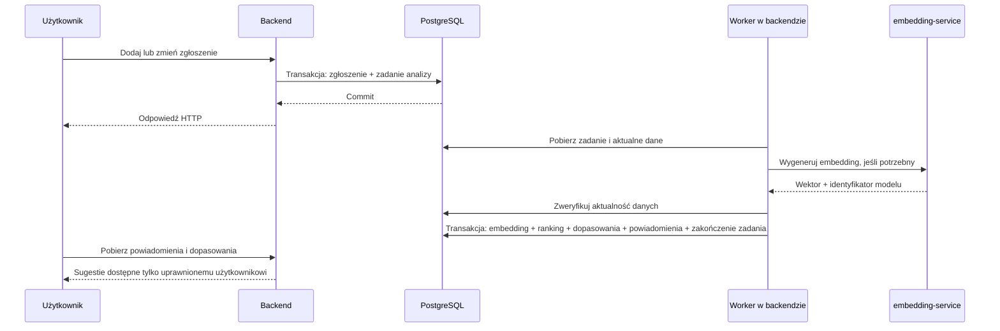

# Automatyczne dopasowywanie zgłoszeń LOST/FOUND

> Status: propozycja techniczna do wdrożenia. Dokument opisuje plan, a nie istniejące funkcje aplikacji. Powstał na podstawie analizy repozytorium z 12 listopada 2026 r.

## 1. Cel i decyzja architektoniczna

Po utworzeniu lub istotnej zmianie zgłoszenia system automatycznie wyszukuje potencjalne pary LOST/FOUND, zapisuje ranking i tworzy powiadomienia dla obu autorów. Analiza odbywa się asynchronicznie i nie blokuje żądania HTTP zapisującego zgłoszenie.

Proponowana architektura wykorzystuje obecny backend Spring, istniejący `embedding-service` oraz PostgreSQL. PostgreSQL przechowuje embeddingi, dopasowania, powiadomienia i trwałą kolejkę zadań. Worker działa wewnątrz backendu.

Na MVP nie dodajemy brokera wiadomości ani kolejnego serwisu. Dopasowanie pozostaje sugestią: nie potwierdza własności i nie oznacza automatycznie przedmiotu jako odzyskanego.

## 2. Stan obecnego projektu

| Obszar | Obecny stan |
| --- | --- |
| Backend | Java 21, Spring Boot 4.1.2, Spring MVC, Spring Data JPA/Hibernate |
| Zapis zgłoszeń | Transakcyjne `create`, `update`, `resolve`, `delete` w `ReportService` |
| Współbieżność edycji | `@Version` w encji `Report`, obsługa konfliktów HTTP 409 |
| Baza | PostgreSQL 18, PostGIS, pgvector włączany migracją V4 |
| Lokalizacja | `geography(Point,4326)`, indeks GiST, wyszukiwanie promieniem w metrach |
| Migracje | Flyway; Hibernate jedynie waliduje schemat |
| AI | Osobny Pythonowy `embedding-service`, model `sdadas/mmlw-roberta-base`, CPU |
| Powiadomienia i zadania | Brak istniejącego mechanizmu |
| Testy | JUnit, MockMvc, Testcontainers z własnym obrazem PostGIS/pgvector; frontend używa Vitest |

Istotne pliki:

- [ReportService.java](../foundly-backend/src/main/java/pl/szymonprofic/foundlybackend/services/ReportService.java) — zapis, edycja, zakończenie i usuwanie zgłoszeń.
- [Report.java](../foundly-backend/src/main/java/pl/szymonprofic/foundlybackend/models/Report.java) — model zgłoszenia i blokada optymistyczna.
- [ReportSpecifications.java](../foundly-backend/src/main/java/pl/szymonprofic/foundlybackend/repositories/specifications/ReportSpecifications.java) — obecne filtry tekstowe i przestrzenne.
- [Migracje Flyway](../foundly-backend/src/main/resources/db/migration) — obecny schemat bazy.
- [server.py](../embedding-service/server.py) — istniejące API generowania embeddingów.
- [Dockerfile PostgreSQL](../docker/postgres/Dockerfile) — obraz PostGIS rozszerzony o pgvector.
- [docker-compose.yml](../docker-compose.yml) — konfiguracja usług.
- [ReportApiTests.java](../foundly-backend/src/test/java/pl/szymonprofic/foundlybackend/ReportApiTests.java) — testy API, migracji i bazy.

## 3. Przepływ danych



Awaria AI nie blokuje publikacji zgłoszenia. Użytkownik widzi stan „Analizujemy potencjalne dopasowania”, a worker ponawia analizę. Zapis zgłoszenia i zaplanowanie analizy należą do tej samej transakcji.

Wywołanie HTTP do AI odbywa się poza transakcją i bez blokad w bazie.

## 4. Komponenty backendu

Zachowujemy obecny układ kontrolerów, serwisów, repozytoriów i DTO.

| Komponent | Odpowiedzialność |
| --- | --- |
| `MatchingJobService` | Zaplanowanie analizy w transakcji zgłoszenia |
| `MatchingWorker` | Pobieranie zadań, retry, odzyskiwanie po awarii |
| `EmbeddingTextBuilder` | Deterministyczne przygotowanie tekstu i jego hasha |
| `EmbeddingClient` | Wywołanie istniejącego `embedding-service` |
| `MatchingRepository` | Zapytania pgvector/PostGIS i atomowe operacje kolejki |
| `MatchingScoreCalculator` | Czyste obliczenia rankingu, łatwe do testowania |
| `ReportMatchService` | Dostęp do dopasowań i decyzje użytkowników |
| `NotificationService` | Utworzenie i odczyt powiadomień w aplikacji |

Dla encji domenowych pozostaje JPA. Dla kolejki i zapytań wektorowo-przestrzennych proponowany jest jawny SQL przez `JdbcTemplate` lub `NamedParameterJdbcTemplate`. Nie próbujemy wyrażać całego rankingu przez JPA Specifications.

Transakcje workera mają wyraźne granice, przez osobne beany lub `TransactionTemplate`. Należy uniknąć polegania na wywołaniu metody z `@Transactional` wewnątrz tego samego obiektu.

## 5. Generowanie embeddingów

### 5.1. Wykorzystanie istniejącego serwisu

`embedding-service` pozostaje jedynym miejscem uruchamiania modelu. Backend nie ładuje modelu i nie wysyła tekstu do zewnętrznego dostawcy AI.

Adres w Compose: `http://embedding-service:8000/`. Dla backendu uruchomionego lokalnie: `http://localhost:8000/`. Adres powinien być konfigurowalny.

### 5.2. Tekst wejściowy

Tekst budujemy z tytułu, opisu i koloru, jeśli został podany. Lokalizacja i data pozostają osobnymi sygnałami rankingu. Kategorii początkowo nie dodajemy do embeddingu, aby błędny wybór kategorii nie wpływał na dopasowanie dwukrotnie.

Usuwamy tylko rozpoznane wstępy typu „Zgubiłem” czy „Znaleziono”, bez agresywnego czyszczenia treści. Zachowujemy negacje, marki i cechy odróżniające przedmiot, np. „bez zamka” czy „pęknięta obudowa”. Takie przygotowanie tekstu ma własną wersję.

Embedding powinien reprezentować cechy przedmiotu, a nie sam fakt zgubienia lub znalezienia. Nie jest potrzebny dodatkowy LLM do przepisywania opisu na MVP.

### 5.3. Wymiar i role tekstów

Model `sdadas/mmlw-roberta-base` zwraca **768 wymiarów**. Parametr `truncate_dim=1024` w obecnym serwisie nie powiększa wektora do 1024 wymiarów.

Dokumentacja modelu wymaga prefiksu `zapytanie: ` po stronie zapytania. Proponowana stała konwencja:

- LOST jest zapytaniem: `zapytanie: <cechy przedmiotu>`.
- FOUND jest dokumentem: `<cechy przedmiotu>`, bez prefiksu.

Konwencja obowiązuje niezależnie od tego, które zgłoszenie uruchamia analizę. Dzięki temu para otrzymuje ten sam wynik przy analizie z obu stron. Wybór trzeba zweryfikować na ocenionych przykładach LOST/FOUND.

Źródło: [dokumentacja modelu](https://huggingface.co/sdadas/mmlw-roberta-base).

### 5.4. Docelowy kontrakt i niezawodność

Odpowiedź serwisu powinna identyfikować model, jego rewizję i wymiar wektora. Backend waliduje liczbę wymiarów, skończoność wartości i normę wektora.

Przed wykorzystaniem produkcyjnym potrzebne są:

- timeout połączenia i całego żądania;
- limit rozmiaru wejścia i kontrolowana obsługa limitu tokenów modelu;
- przypięte wersje zależności i rewizja modelu;
- endpoint gotowości modelu;
- obsługa niezgodności kontraktu jako błędu wymagającego interwencji, zamiast nieskończonych ponowień.

Obecny `HTTPServer` przetwarza żądania kolejno. Na początek dopasowujemy do niego współbieżność workera: jedno wywołanie AI naraz. Większą przepustowość wprowadzamy po pomiarach.

## 6. Proponowane zmiany schematu

### 6.1. Oddzielenie danych technicznych od zgłoszenia

Zamiast umieszczać duży wektor bezpośrednio w encji `Report`, proponowana jest osobna tabela `report_embedding` w relacji 1:1. Zwykłe listowanie zgłoszeń nie ładuje embeddingów, a techniczne aktualizacje AI nie zmieniają wersji edytowanego przez użytkownika ogłoszenia.

| Tabela | Najważniejsze dane |
| --- | --- |
| `report` | Nowe `matching_revision` i hash aktualnego tekstu wejściowego |
| `report_embedding` | `report_id` jako PK/FK, `embedding vector(768)`, model, rewizja modelu, wersja przygotowania tekstu, hash wejścia, czas wygenerowania |
| `matching_job` | Zgłoszenie, docelowa rewizja, wersja procesu, status, liczba prób, termin kolejnej próby, dzierżawa zadania, token wykonawcy, ostatni błąd |
| `report_match` | Kanoniczna para LOST/FOUND, składowe rankingu, wynik końcowy, wersja rankingu, rewizje obu zgłoszeń, status, daty, wersja do kontroli współbieżności |
| `report_match_decision` | Decyzja konkretnego autora dotycząca określonej wersji dopasowania |
| `notification` | Odbiorca, dopasowanie, typ powiadomienia, czas utworzenia i odczytania |

`report_match` powinno przechowywać co najmniej `semantic_score`, `location_score`, `date_score`, `category_score`, `final_score` oraz informacje o dostępności sygnałów. Brakująca składowa nie jest tym samym co wynik zero.

### 6.2. Ograniczenia i indeksy

- `UNIQUE(lost_report_id, found_report_id)` — jedna kanoniczna para.
- Różne identyfikatory zgłoszeń w parze.
- Unikalne zadanie dla zgłoszenia, rewizji i wersji procesu.
- Unikalne powiadomienie dla odbiorcy, pary i rodzaju zdarzenia.
- Wyniki rankingu ograniczone do `[0,1]`.
- Indeksy na obu FK dopasowania, powiadomieniach odbiorcy i zadaniach gotowych do wykonania.
- Jawne zasady usuwania dla nowych FK, aby istniejący `delete` zgłoszenia nie zaczął kończyć się błędem integralności. Powiązane sugestie należy usunąć lub wycofać, a powiadomienia nie mogą prowadzić do niedostępnych danych.

Zwykły `CHECK` nie sprawdzi typu zgłoszenia wskazanego przez FK. Kanoniczną kolejność LOST/FOUND zapewnia serwis i testy integracyjne. Obecnie typ zgłoszenia jest niezmienny, co upraszcza regułę.

`matching_revision` zmienia się przy zmianie danych wpływających na dopasowanie. Istniejący `@Version` pozostaje mechanizmem kontroli edycji HTTP. Aktualność embeddingu zależy od hasha tekstu, modelu i wersji przygotowania tekstu; sama zmiana lokalizacji nie unieważnia wektora.

Migracje dodajemy jako nowe wersje Flyway. Nie zmieniamy migracji V1–V4, które mogły już zostać wykonane.

## 7. Trwała kolejka i transactional outbox

Tabela `matching_job` jest jednocześnie uproszczonym transactional outboxem i kolejką pracy. Nie potrzebujemy osobnej tabeli zdarzeń, która tylko przekazywałaby dane do drugiej tabeli zadań.

Przy zapisie zgłoszenia backend:

1. Porównuje istotne pola.
2. Aktualizuje rewizję analizy i ewentualnie hash tekstu.
3. W tej samej transakcji zapisuje zadanie.
4. Udostępnia zadanie workerowi dopiero po commicie.

Worker uruchamiany przez scheduler Spring pobiera gotowe zadania za pomocą `FOR UPDATE SKIP LOCKED`. Pobranie jest krótką transakcją: zapisuje status `PROCESSING`, termin wygaśnięcia dzierżawy i unikalny token wykonania, po czym zwalnia blokady.

Po awarii zadanie z wygasłą dzierżawą wraca do wykonania. Token zabezpiecza przed spóźnionym workerem, który próbuje zakończyć zadanie przejęte już przez inny proces.

Przewidujemy przetwarzanie **co najmniej raz**, z idempotentnym zapisem efektów:

- ponowienia z rosnącym opóźnieniem i losowym rozrzutem;
- ograniczoną liczbę prób;
- status `DEAD` i możliwość kontrolowanego ponowienia;
- rozróżnienie błędów przejściowych od trwałych;
- wykrywanie zgłoszeń bez aktualnego embeddingu lub bez zakończonej analizy;
- pomijanie nieaktualnych zadań, gdy nowsza rewizja ma już zaplanowaną analizę.

Zadania powinny wskazywać zgłoszenie i rewizję, bez kopiowania pełnego opisu i danych użytkownika do kolejki.

Samo `@Async` albo zdarzenie po commicie nie zapewnia trwałości przy awarii procesu.

Źródła: [PostgreSQL — blokowanie i SKIP LOCKED](https://www.postgresql.org/docs/18/sql-select.html#SQL-FOR-UPDATE-SHARE), [Spring — wykonywanie zadań i harmonogramy](https://docs.spring.io/spring-framework/reference/integration/scheduling.html).

## 8. Edycje i współbieżność

### 8.1. Kiedy przeliczać embedding

| Zmiana | Generowanie embeddingu | Ponowny ranking |
| --- | --- | --- |
| Tytuł, opis, kolor | Tak, jeśli zmienił się hash tekstu | Tak |
| Kategoria | Nie | Tak |
| Lokalizacja | Nie | Tak |
| Data zdarzenia | Nie | Tak |
| Zakończenie/usunięcie | Nie | Wycofanie aktualnych sugestii |
| Nowy model lub sposób przygotowania tekstu | Tak | Tak |

Przed zapisaniem wyniku worker ponownie sprawdza rewizję zgłoszenia. Wynik ze starego opisu nie może nadpisać aktualnego embeddingu. Jeśli zmieniła się tylko lokalizacja, wygenerowany embedding może nadal pasować, ale ranking musi wykorzystać nowe dane.

### 8.2. Dwa równoczesne zgłoszenia

Dwa nowe zgłoszenia mogą jednocześnie wygenerować embedding i każde nie zobaczyć jeszcze drugiego. Sama unikalność pary chroni przed duplikatami, ale nie przed pominięciem dopasowania.

Na MVP proponowana jest serializacja krótkiej transakcji publikacji embeddingu i dopasowań blokadą doradczą PostgreSQL. Obejmuje ona zapis wektora, wybór kandydatów, zapis dopasowań i powiadomień. Nie obejmuje wywołania AI. Przy izolacji `READ COMMITTED` druga publikacja zobaczy już zatwierdzoną pierwszą.

Przed utrwaleniem pary blokujemy odpowiednie zgłoszenia w stałej kolejności i ponownie sprawdzamy ich rewizje oraz statusy. Ten sam porządek blokad obowiązuje przy decyzjach i wycofywaniu dopasowań. Zmienionego kandydata należy przeliczyć lub odrzucić jako nieaktualnego, a nie zapisać wynik ze starego obrazu danych.

Serializacja publikacji jest świadomym uproszczeniem dla niewielkiej skali. Przy większym ruchu można rozdzielić publikowanie embeddingów i analizę na osobne trwałe zadania, zachowując mechanizm uzupełniania pominiętych analiz.

## 9. Wyszukiwanie kandydatów i ranking hybrydowy

### 9.1. Warunki kwalifikacji

Twarde warunki początkowe:

- przeciwny typ zgłoszenia;
- oba zgłoszenia aktywne;
- różni autorzy;
- aktualne, zgodne embeddingi;
- para nie została odrzucona przez użytkownika.

Zgodność kategorii nie jest obowiązkowym filtrem. Błędna kategoria nie powinna wykluczać dobrego dopasowania.

Na MVP, przy niewielkiej bazie, wykonujemy dokładne porównanie kwalifikujących się kandydatów i ranking hybrydowy przed wybraniem najlepszych wyników. Wcześniejsze ograniczenie do kilku najbliższych wektorów mogłoby zgubić parę z nieco słabszą semantyką, ale znacznie lepszą lokalizacją i datą.

### 9.2. Składowe rankingu

| Sygnał | Proponowana normalizacja |
| --- | --- |
| Semantyka `S` | Podobieństwo cosinusowe ograniczone do `[0,1]` |
| Lokalizacja `L` | `exp(-odległość / skala_odległości)` |
| Data `D` | Malejąca funkcja odstępu między zgubieniem a znalezieniem |
| Kategoria `C` | `1` dla zgodnej; `0` dla różnej; nieznana/„Inne” jako brak wiarygodnego sygnału |

Dla kompletnych danych:

```text
wynik = 0.60 × S + 0.20 × L + 0.10 × D + 0.10 × C
```

Przy brakujących sygnałach sumę dzielimy przez sumę dostępnych wag. Dodatkowo zapisujemy kompletność danych, aby wynik przy brakującej lokalizacji nie wyglądał na równie dobrze uzasadniony.

Wagi, skale, tolerancje i progi są konfigurowalne i mają wersję zapisywaną przy wyniku. Potrzebne są osobno:

- minimalna semantyka — lokalizacja nie może uratować zupełnie innego przedmiotu;
- próg zapisania sugestii;
- wyższy próg wysłania powiadomienia;
- limit prezentowanych i powiadamianych propozycji.

Wynik rankingu nie jest prawdopodobieństwem własności. Interfejs nie powinien przedstawiać go jako „87% pewności”.

### 9.3. Lokalizacja i data

Odległość obliczamy przez PostGIS na `geography`, w metrach. Duża odległość obniża ranking, ale sama nie musi wykluczać pary: przedmiot mógł zostać przewieziony.

Dla dat uwzględniamy kierunek: znalezienie kilka dni po zgubieniu jest naturalne; znalezienie wcześniej wymaga tolerancji dla niedokładnej daty. Nie stosujemy prostego warunku równości dat ani ostrego odrzucania niewielkiej odwrotnej kolejności.

Pełna obsługa przybliżonych danych wymaga informacji o dokładności lokalizacji oraz przedziału dat. Ranking powinien uwzględniać te przedziały, zamiast traktować umowny środek miasta lub przybliżoną datę jako dane dokładne.

### 9.4. HNSW i skalowanie

HNSW z `vector_cosine_ops` dodajemy po pomiarach. Przy większej bazie zastosujemy szerszą listę kandydatów wektorowych i przestrzennych, a następnie dokładny ranking.

Należy zmierzyć recall kandydatów. Przy indeksach przybliżonych filtrowanie może ograniczyć liczbę zwracanych wyników; potrzebne mogą być szersza pula, iterative scans lub zmiana strategii filtrowania.

Źródło: [pgvector — filtrowanie](https://github.com/pgvector/pgvector#filtering).

## 10. Cykl życia dopasowania i decyzje użytkowników

| Status | Znaczenie |
| --- | --- |
| `PROPOSED` | Automatyczna sugestia |
| `CONFIRMED` | Obie strony zaakceptowały sugestię |
| `REJECTED` | Co najmniej jedna strona ją odrzuciła |
| `EXPIRED` | Sugestia przestała być aktualna |

`CONFIRMED` nie jest potwierdzeniem własności ani automatycznym odzyskaniem przedmiotu. Zakończenie zgłoszenia pozostaje osobną operacją właściciela.

Każdy autor podejmuje własną decyzję. Decyzje wiążemy z rewizjami danych, które użytkownik oceniał. Istotna edycja nie może przenieść wcześniejszej akceptacji na zmieniony przedmiot bez ponownej oceny. Historia decyzji powinna pozostać dostępna; nie nadpisujemy jej wynikiem automatycznego rankingu.

Odrzucenia nie przywraca automatyczny reranking. Ewentualne ponowne otwarcie odrzuconej pary wymaga osobnej, jawnej reguły produktu.

Przeliczenie aktualizuje wyniki, ale nie nadpisuje decyzji użytkowników. Analizujemy również istniejące dopasowania danego zgłoszenia, aby wycofać nieaktualne pary, a nie wyłącznie dodawać nowe. Odczyt API i zapis decyzji muszą weryfikować aktualność, nawet jeśli zadanie wycofania sugestii jeszcze oczekuje w kolejce.

## 11. Powiadomienia

Powiadomienia obu autorów powstają w tej samej transakcji co kwalifikujące się dopasowanie. Unikalność w bazie zabezpiecza przed powtórzeniem przy retry lub analizie z drugiej strony.

Przeliczenie tej samej pary nie generuje kolejnego powiadomienia. Na MVP wystarczy zapis w aplikacji i okresowe odpytywanie API.

Przykładowa treść:

> Znaleźliśmy potencjalne dopasowanie do Twojego ogłoszenia. Sprawdź, czy chodzi o ten sam przedmiot.

Późniejsze e-maile i push otrzymują osobną tabelę `notification_delivery`, przechowującą kanał, status i próby dostarczenia. Odczytanie powiadomienia w aplikacji jest inną informacją niż powodzenie wysyłki e-maila. Dla zewnętrznych kanałów potrzebne są niezależne ponowienia i klucze idempotencji, jeśli dostawca je obsługuje.

## 12. Proponowane API i interfejs

| Endpoint | Dostęp i działanie |
| --- | --- |
| `GET /api/reports/{id}/matches` | Właściciel zgłoszenia; ranking aktualnych sugestii |
| `GET /api/reports/{id}/matching-status` | Właściciel; oczekiwanie, analiza, gotowe, błąd |
| `GET /api/matches/{id}` | Jeden z autorów pary |
| `PUT /api/matches/{id}/my-decision` | Własna decyzja i wersja ocenianego dopasowania |
| `GET /api/notifications` | Własne powiadomienia, paginacja |
| `GET /api/notifications/unread-count` | Własny licznik |
| `PUT /api/notifications/{id}/read` | Idempotentne oznaczenie własnego powiadomienia |

Odbiorcy i autora decyzji nie przyjmujemy jako dowolnego UUID z żądania. Ustalamy ich na podstawie zalogowanej tożsamości Keycloak. Sprawdzenie własności zasobu jest wymagane niezależnie od reguł ścieżek w Spring Security.

Frontend otrzymuje widok sugestii przy własnym zgłoszeniu, decyzje obu stron oraz licznik i listę powiadomień. Początkowo nie są potrzebne WebSockety ani SSE.

## 13. Prywatność i problemy obecnego projektu

### 13.1. Publiczna dokładna lokalizacja

`ReportService.response()` zwraca obecnie dokładny punkt w publicznych szczegółach. Test `publicDetailsExposeMapPointWithoutGrantingOwnership` jawnie potwierdza to zachowanie.

Jeśli punkt ma być chroniony, trzeba zmienić istniejący kontrakt API i prezentację mapy, również poza endpointami dopasowań. Dla innych użytkowników należy rozważyć przybliżony obszar, a dokładny punkt pozostawić autorowi. Sama akceptacja sugestii nie powinna automatycznie otwierać dostępu do prywatnych danych.

### 13.2. Brak reprezentacji nieznanych i przybliżonych danych

Lokalizacja i data są dziś wymagane w bazie, encji i DTO. Pełna obsługa wymaga opcjonalnego punktu, informacji o dokładności lokalizacji oraz przedziału dat.

To zmiana obejmująca również formularze i istniejące DTO. Nie podstawiamy fikcyjnych współrzędnych ani dat. Do czasu rozszerzenia kontraktu ranking działa na obecnych, wymaganych danych, a funkcje obliczeniowe powinny być przygotowane na brak sygnału.

### 13.3. Wersjonowanie modelu

Obecne API embeddingów zwraca tylko tekst i wektor. Wektory z różnych rewizji modelu lub przygotowania tekstu nie mogą być bezwarunkowo porównywane. Zmiana wymiaru wymaga osobnego planu migracji i ponownego przeliczenia danych.

### 13.4. Testy i budowanie

Dockerfile backendu pomija testy. Weryfikację trzeba uruchamiać osobno w CI. Istniejący test OpenAPI oczekuje braku endpointu `/api/reports/{id}/matches` i będzie wymagał aktualizacji.

### 13.5. Minimalizacja danych

Do `embedding-service` wysyłamy wyłącznie potrzebny tekst przedmiotu, bez danych profilu, e-maila i dokładnego punktu. Należy uwzględnić, że sam opis użytkownika może zawierać dane osobowe; nie logujemy pełnych opisów i wektorów w diagnostyce.

Inferencja jest lokalna. Pobieranie modelu przy starcie jest osobnym połączeniem sieciowym; dla wdrożenia należy zapewnić kontrolowane pobranie i cache modelu.

W produkcji serwis AI jest dostępny tylko wewnętrznie. Dopasowania korzystają z osobnych DTO bez danych kontaktowych i prywatnych cech służących weryfikacji właściciela. Jeśli takie cechy mają być chronione, potrzebne jest osobne pole lub mechanizm weryfikacji — obecny publiczny opis nie zapewnia ich poufności.

## 14. Plan testów

| Poziom | Najważniejsze przypadki |
| --- | --- |
| Jednostkowe | Budowanie tekstu, hash, decyzja o ponownym embeddingu, normalizacja wag, kierunek dat, brakujące dane, progi |
| PostgreSQL/Testcontainers | Migracje, pgvector/PostGIS, unikalność par, atomowy outbox, przejmowanie zadań, wygaśnięcie dzierżawy |
| Wyścigi i awarie | Dwa równoczesne zgłoszenia, edycja podczas AI, zakończenie/usunięcie podczas analizy, awaria przed i po commicie, spóźniony worker |
| API i bezpieczeństwo | Tylko własne dopasowania i powiadomienia, własna decyzja, konflikty wersji, brak wycieku profili i dokładnej lokalizacji |
| Integracja AI | Timeout, HTTP 500, niepoprawny wektor, inny model, zbyt długi tekst, ponowienie bez duplikatów |
| Jakość | Precision@K, recall kandydatów, liczba nietrafnych powiadomień i czas od publikacji do sugestii |

Testy logiki korzystają z kontrolowanych wektorów i atrap HTTP. Osobny zestaw jakościowy sprawdza rzeczywisty model, bez uzależniania wszystkich testów aplikacji od pobierania modelu i czasu inferencji.

Zestaw jakościowy powinien zawierać ręcznie ocenione pozytywne i negatywne pary. Szczególnie ważne są trudne negatywne przykłady: bardzo podobne przedmioty należące do różnych osób. Dane do strojenia progów i dane końcowej oceny powinny być rozdzielone.

## 15. Etapy realizacji

1. **Kontrakty i dane testowe.** Zdefiniować znaczenie akceptacji, zasady lokalizacji i dat, przygotować ocenione pary. Uzgodnić zakres zmian dotyczących prywatności oraz danych przybliżonych.
2. **Trwałe zadania i integracja AI.** Dodać schemat, kolejkę, worker, klienta embedding-service, kontrolę rewizji, retry i przeliczenie istniejących aktywnych zgłoszeń. Mierzyć jakość bez powiadamiania użytkowników.
3. **Ranking i zapis dopasowań.** Dokładne wyszukiwanie, konfigurowalne składowe, idempotentny zapis par i wycofywanie nieaktualnych wyników.
4. **Powiadomienia i frontend.** Widok sugestii przy własnym zgłoszeniu, decyzje obu stron, licznik i lista powiadomień.
5. **Przygotowanie produkcyjne.** Metryki opóźnienia kolejki, błędów AI i martwych zadań; limity przetwarzania; bezpieczne odtwarzanie analizy; test obciążenia i stopniowe włączenie powiadomień.

MVP zawiera trwałość zadań, kontrolę aktualności i deduplikację. HNSW, równoległe generowanie embeddingów, e-mail, push, WebSockety i dodatkowy model oceniający pary mogą poczekać na wyniki pomiarów.

## 16. Kryteria akceptacji MVP

- Zgłoszenie zapisuje się również przy niedostępnym serwisie AI.
- Utworzenie lub istotna edycja automatycznie planuje analizę.
- Awaria backendu nie gubi zatwierdzonego zadania.
- Nieaktualny worker nie nadpisuje nowszych danych.
- Równoczesne dodanie LOST i FOUND nie pomija pary z powodu kolejności publikacji embeddingów.
- Każda para ma jeden rekord, a każdy autor otrzymuje najwyżej jedno powiadomienie danego typu dla tej pary.
- Zakończone, usunięte i nieaktualne zgłoszenia nie są prezentowane jako bieżące sugestie.
- Użytkownik może odczytać wyłącznie swoje dopasowania i powiadomienia oraz zapisać wyłącznie własną decyzję.
- Wynik nie jest przedstawiany jako prawdopodobieństwo własności, a sugestia nie kończy automatycznie zgłoszeń.
- Istniejące aktywne zgłoszenia mogą zostać przeanalizowane przez kontrolowany backfill.
- Jakość rankingu i czas przetwarzania są zmierzone na ustalonym zestawie danych przed włączeniem automatycznych powiadomień.
