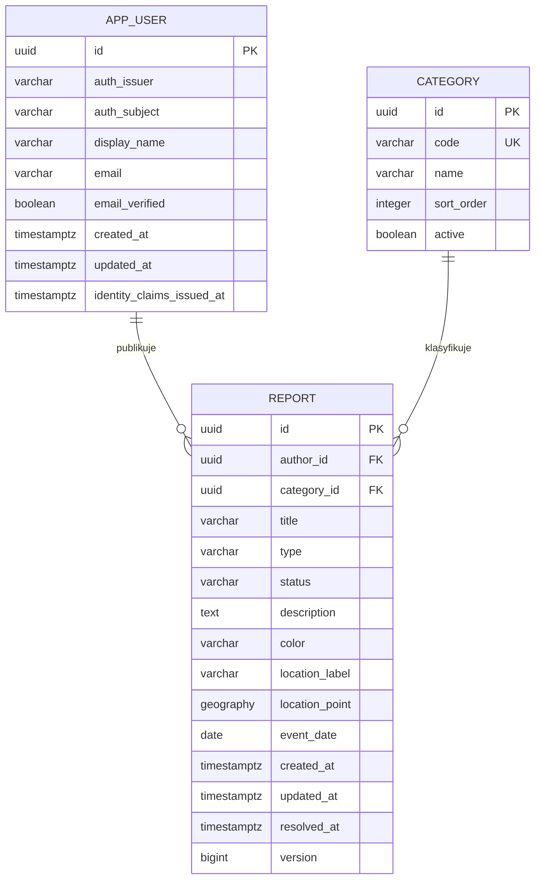

# Foundly — model danych i encje backendowe

## 1. Cel i podstawa projektu

Dokument proponuje model dla backendu Java 21 / Spring Boot / Spring Data JPA oraz PostgreSQL z rozszerzeniem **PostGIS**. Określa projekt domeny; wstępne REST API implementujące ten model opisuje [README backendu](README.md).

**Uwierzytelnianie będzie realizowane przez Keycloak (OpenID Connect).** Ta decyzja doprecyzowuje otwarty wybór dostawcy opisany w głównym README. Keycloak zarządza kontami i logowaniem, a baza Foundly przechowuje lokalny profil autora oraz dane domenowe.

Podstawą są:

- [główne README](../README.md): konta, CRUD zgłoszeń, wyszukiwanie, „Moje zgłoszenia”, odzyskanie przedmiotu i podstawowe dopasowywanie;
- [README frontendu](../frontend/README.md), [typ Report](../frontend/src/types/report.ts), [ReportCard](../frontend/src/components/ReportCard/ReportCard.tsx) i [dane demonstracyjne](../frontend/src/demo/reports.ts).

Frontend implementuje podgląd trzech kart oraz logowanie Keycloak i synchronizację własnego profilu z API. Formularze zgłoszeń, wyszukiwarka i pobieranie kart z API pozostają do wdrożenia. Karta używa kategorii, tekstowej lokalizacji, daty zdarzenia i flagi zakończenia; ikony są elementem prezentacji, nie zdjęciami przedmiotów.

**Propozycja MVP: trzy encje trwałe — `AppUser`, `Category`, `Report`.** Bieżący sprint obejmuje CRUD zgłoszeń i ich ręczne wyszukiwanie; automatyczne dopasowywanie odkładamy do kolejnego sprintu. Zdjęcia, wiadomości, powiadomienia i moderacja pozostają rozszerzeniami. Nie tworzymy osobnej encji `Item`: na tym etapie opis przedmiotu jest częścią zgłoszenia, a dwa podobne zgłoszenia nie muszą dotyczyć tej samej rzeczy.

Wartości limitów i parametry algorytmu podane poniżej są proponowanymi decyzjami projektowymi, nie wymaganiami już zaimplementowanego interfejsu.

## 2. Relacje



Każde zgłoszenie ma dokładnie jednego autora i jedną kategorię. Autor i kategoria mogą istnieć bez zgłoszeń. Para `(auth_issuer, auth_subject)` jest unikalna. Diagram skraca definicję punktu do `geography`; pełny typ SQL to `geography(Point, 4326)`.

Konto Keycloak jest zewnętrzną tożsamością powiązaną logicznie z `AppUser` przez `(iss, sub)`. Nie jest encją JPA Foundly: nie tworzymy FK do wewnętrznych tabel Keycloak ani nie odczytujemy ich bezpośrednio. Keycloak używa własnej bazy lub odrębnej bazy logicznej i użytkownika DB; migracje Foundly nie zarządzają jego schematem.

## 3. Konwencje

- Identyfikatory: `UUID` generowane przez backend, przesyłane w JSON jako ciągi znaków. Identyfikatory `1`, `2`, `3` z demonstracji nie wyznaczają typu klucza bazy.
- Nazwy klas i pól Javy: `PascalCase` / `camelCase`; tabele i kolumny: `snake_case`.
- Data zdarzenia: `LocalDate` / SQL `date`, JSON `YYYY-MM-DD`. Nie reprezentuje północy UTC.
- Znaczniki audytu: `Instant` / `timestamptz`, odpowiedzi API w UTC. `createdAt` i `updatedAt` ustala backend.
- Enumy: `@Enumerated(EnumType.STRING)`, SQL `varchar` z `CHECK`; nie zapisujemy numerów porządkowych enumów.
- Wszystkie pola są wymagane (`NOT NULL`), chyba że tabela wyraźnie dopuszcza brak wartości.
- Encje nie są bezpośrednio serializowane przez kontrolery. Osobne DTO oddzielają strukturę bazy od interfejsu oraz danych uwierzytelniania.

## 4. Encje trwałe

### 4.1. `AppUser` → `app_user`

Lokalna reprezentacja autora powiązana z kontem **Keycloak**. `AppUser` nie odpowiada za logowanie: pozwala utrzymać lokalny FK `Report.author`, nazwę wyświetlaną i niezależny od dostawcy identyfikator domenowy. Nie dodajemy tabel haseł, sesji, refresh tokenów ani kopii ról Keycloak.

| Pole Java | Kolumna / SQL | Reguła |
| --- | --- | --- |
| `id` | `id uuid` | Lokalny PK Foundly; odrębny od identyfikatora Keycloak |
| `authIssuer` | `auth_issuer varchar(512)` | Dokładna wartość `iss` zweryfikowanego tokenu, np. `https://auth.example.org/realms/foundly` |
| `authSubject` | `auth_subject varchar(255)` | Wartość `sub` zweryfikowanego tokenu Keycloak; niezmienny identyfikator powiązania |
| `displayName` | `display_name varchar(100)` | Lokalna kopia nazwy do prezentacji, bez znaczenia dla autoryzacji |
| `createdAt` | `created_at timestamptz` | Moment utworzenia lokalnego profilu |
| `email` | `email varchar(254)` | Opcjonalna lokalna kopia adresu z tokenu Keycloak |
| `emailVerified` | `email_verified boolean` | Stan weryfikacji adresu; bez adresu zawsze `false` |
| `updatedAt` | `updated_at timestamptz` | Ostatnia przyjęta synchronizacja profilu |
| `identityClaimsIssuedAt` | `identity_claims_issued_at timestamptz` | `iat` ostatniego przyjętego tokenu; opcjonalny dla rekordów sprzed migracji |

Ograniczenie `UNIQUE (auth_issuer, auth_subject)` identyfikuje konto w konkretnym realmie; nazwa wyświetlana nie jest unikalna. `authSubject` pozostaje stringiem, nawet jeśli Keycloak nada identyfikator w formacie UUID. Nie używamy adresu e-mail ani `preferred_username` jako klucza tożsamości: mogą się zmieniać. Adres jest kopiowany z Keycloak na potrzeby własnego profilu i przyszłych powiadomień. Nie ma ograniczenia unikalności; zmiana adresu nigdy nie zmienia lokalnego identyfikatora ani autorstwa.

Po zalogowaniu do aplikacji frontend wywołuje **`PUT /api/me` bez body**, a backend tworzy lub synchronizuje profil z access tokenu. Operacja zwraca 201 przy utworzeniu i 200 przy synchronizacji. Jest ponawiana po odświeżeniu tokenu. `GET /api/me` tylko odczytuje profil i zwraca 404, jeśli rekord jeszcze nie istnieje. Publikacja i „Moje zgłoszenia” zachowują inicjalizację jako zabezpieczenie dla klientów API, którzy nie wywołali PUT. Samo założenie konta lub logowanie w Keycloak bez żądania do Foundly nie tworzy lokalnego rekordu.

`CurrentUserService` rozwiązuje tożsamość i waliduje dane tokenu, a `ProfileSynchronizationService` zapisuje encję przez JPA w osobnej transakcji. Dla istniejącego profilu używamy `PESSIMISTIC_WRITE`; konflikt unikalności `(iss, sub)` przy równoczesnym pierwszym żądaniu jest ponawiany po rollbacku w nowej transakcji. Kontroler rozwiązuje profil przed rozpoczęciem transakcji zgłoszenia, żeby nie zajmować połączenia zewnętrznej transakcji podczas inicjalizacji użytkownika.

`displayName` pochodzi z `preferred_username` (maksymalnie 100 znaków, domyślnie „Użytkownik”). E-mail pochodzi z claimu `email`, a weryfikacja wyłącznie z logicznego `email_verified` w tokenie. Brak adresu daje `NULL` i `false`. Wymagany jest rzeczywisty claim `iat`; starszy token nie może nadpisać danych zapisanych na podstawie nowszego. Przy takim samym `iat` (jedna sekunda) pierwszy przyjęty stan pozostaje bez zmian. Nie wykonujemy wywołania Keycloak Admin API przy żądaniu aplikacyjnym i nie przyjmujemy e-maila ani autorstwa z body.

E-mail jest widoczny wyłącznie we własnym profilu. Przyszłe powiadomienia mogą korzystać z adresu dopiero, gdy jest niepusty i zweryfikowany. Wysyłka i preferencje powiadomień pozostają poza bieżącym sprintem. Lokalna kopia nie jest synchronizowana natychmiast po zmianie dokonanej w Keycloak podczas nieobecności użytkownika.

Usuwanie konta nie należy do bieżącego MVP. FK autora używa `ON DELETE RESTRICT`; ewentualne usunięcie konta wymaga jawnej obsługi jego zgłoszeń. Publiczne DTO nie ujawniają `authIssuer` ani `authSubject`.

Usunięcie lub zablokowanie konta w Keycloak nie usuwa automatycznie `AppUser` ani zgłoszeń. Ponowne założenie konta z tym samym e-mailem, lecz innym `sub`, tworzy nową tożsamość i nie przejmuje starego autorstwa. Zmiana adresu wystawcy lub migracja realmu wymaga kontrolowanej migracji powiązań; nie łączymy kont automatycznie po nazwie ani e-mailu.

### 4.1.1. Podział odpowiedzialności i dostęp

| Obszar | Źródło prawdy |
| --- | --- |
| Rejestracja, hasło, reset hasła, weryfikacja e-maila, MFA i sesja logowania | Keycloak |
| Tożsamość użytkownika API | Zweryfikowany access token Keycloak: `(iss, sub)` |
| Lokalny profil i powiązanie z autorem zgłoszenia | `app_user` w Foundly |
| Autorstwo i prawo do zmiany konkretnego zgłoszenia | `report.author_id` i reguły serwisu Foundly |
| Role, jeśli zostaną dodane np. dla moderatora | Keycloak; bez lokalnych tabel `Role` / `UserRole` w MVP |

Proponujemy realm `foundly`, publicznego klienta SPA `foundly-frontend` oraz klienta reprezentującego API `foundly-backend` jako oczekiwaną wartość audience. Frontend loguje przez **Authorization Code Flow z PKCE S256**, bez client secret w kodzie przeglądarki, i wysyła access token jako `Authorization: Bearer ...`. Rejestracja i zarządzanie kontem prowadzą do ekranów Keycloak. Obsługę sesji frontendu może zapewniać [`keycloak-js`](https://www.keycloak.org/securing-apps/javascript-adapter).

Backend działa jako **Spring Security OAuth2 Resource Server**, bez własnego endpointu przyjmującego login i hasło. Sprawdza podpis JWT, czas ważności (`exp`, `nbf`), dokładny `iss` skonfigurowanego realmu oraz `aud` zawierające `foundly-backend`; wymaga niepustego `sub` użytkownika. W Keycloak trzeba zachować domyślny zakres klienta `basic` dostarczający `sub`, skonfigurować audience mapper dla tokenów frontendu oraz mapper nazwy profilu. Do API trafia access token, a nie ID token. Weryfikacja korzysta z discovery/JWKS Keycloak, zgodnie z dokumentacją [Keycloak OIDC](https://www.keycloak.org/securing-apps/oidc-layers) oraz [Spring Resource Server JWT](https://docs.spring.io/spring-security/reference/servlet/oauth2/resource-server/jwt.html).

Odczyt publicznych kart i kategorii nie wymaga logowania. Publikacja, „Moje zgłoszenia” oraz `GET /api/me` i `PUT /api/me` wymagają użytkownika; edycja, zakończenie i usunięcie wymagają dodatkowo autorstwa. Serwis porównuje `Report.author.id` z lokalnym `AppUser.id` znalezionym po `(iss, sub)`. Sam poprawny token nie daje dostępu do cudzych zgłoszeń. W MVP nie przyjmujemy dostępu przez konta techniczne ani nie nadajemy automatycznego obejścia autorstwa roli administratora.

Jeśli w przyszłości dodamy role klienta API, można mapować `resource_access.foundly-backend.roles` na authorities Spring Security za pomocą jawnego konwertera. Domyślne mapowanie zakresów `scope` nie zastępuje obsługi ról Keycloak. Role pozostają w tokenie, a reguły dostępu do konkretnego zgłoszenia w backendzie.

Przy lokalnej weryfikacji JWT wylogowanie lub blokada konta nie gwarantują natychmiastowego odrzucenia już wydanego access tokenu. MVP zakłada krótką ważność access tokenów (propozycja: 5 minut); natychmiastowe unieważnianie wymagałoby dodatkowego mechanizmu kontroli sesji. Nie dodajemy pola `enabled` do `AppUser`, które sugerowałoby automatyczną synchronizację blokady z Keycloak.

### 4.2. `Category` → `category`

Słownik kategorii pozwala filtrować po stabilnym identyfikatorze, niezależnie od etykiety językowej.

| Pole Java | Kolumna / SQL | Reguła |
| --- | --- | --- |
| `id` | `id uuid` | PK |
| `code` | `code varchar(40)` | Unikalny, stabilny kod techniczny |
| `name` | `name varchar(100)` | Etykieta wyświetlana |
| `sortOrder` | `sort_order integer` | Kolejność, wartość nieujemna |
| `active` | `active boolean` | Czy można wybrać przy tworzeniu zgłoszenia |

Początkowe dane słownika muszą odpowiadać kategoriom komponentu `ReportCard`:

| `code` | `name` |
| --- | --- |
| `ELECTRONICS` | Elektronika |
| `KEYS` | Klucze |
| `WALLETS_DOCUMENTS` | Portfele i dokumenty |
| `BAGS_BACKPACKS` | Torby i plecaki |
| `JEWELLERY` | Biżuteria |
| `OTHER` | Inne |

Dane dodaje migracja. W MVP słownik jest tylko do odczytu przez API. Nie usuwamy kategorii używanej przez zgłoszenia (`ON DELETE RESTRICT`); można ją dezaktywować. Dotychczasowe zgłoszenia nadal ją pokazują, a edycja pozostałych pól nie wymusza jej zmiany. Ikona i wariant kolorystyczny pozostają we frontendzie.

### 4.3. `Report` → `report`

Reprezentuje pojedyncze zgłoszenie zagubienia albo znalezienia.

| Pole Java | Kolumna / SQL | Reguła |
| --- | --- | --- |
| `id` | `id uuid` | PK |
| `author` | `author_id uuid` | FK do `app_user`, relacja `ManyToOne` |
| `category` | `category_id uuid` | FK do `category`, relacja `ManyToOne` |
| `title` | `title varchar(150)` | 3–150 znaków po przycięciu |
| `type` | `type varchar(10)` | `LOST` albo `FOUND` |
| `status` | `status varchar(12)` | `ACTIVE` albo `RESOLVED`, domyślnie `ACTIVE` |
| `description` | `description text` | 10–5000 znaków po przycięciu |
| `color` | `color varchar(80)` | Opcjonalny, `NULL` oznacza nieznany kolor |
| `locationLabel` | `location_label varchar(255)` | 3–255 znaków; np. „Kraków, Stare Miasto” |
| `locationPoint` | `location_point geography(Point,4326)` | Punkt miejsca zdarzenia w WGS 84 |
| `eventDate` | `event_date date` | Data zgubienia/znalezienia, nie data publikacji |
| `createdAt` | `created_at timestamptz` | Data publikacji |
| `updatedAt` | `updated_at timestamptz` | Data ostatniej zmiany |
| `resolvedAt` | `resolved_at timestamptz` | Opcjonalny; wymagany przy `RESOLVED` |
| `version` | `version bigint` | `@Version`, blokada optymistyczna |

`ReportType` i `ReportStatus` są enumami, nie osobnymi encjami. Nie tworzymy osobnych tabel dla zgłoszeń zagubienia i znalezienia, ponieważ mają ten sam zestaw danych. Typ jest niezmienny po publikacji; pomyłkę koryguje usunięcie i ponowne dodanie zgłoszenia. Autor nigdy nie zmienia się przez edycję.

`color` pozostaje tekstem, zgodnie z frontendem. Backend usuwa skrajne białe znaki, a pustą wartość zamienia na `NULL`. Przy porównaniu ignoruje wielkość liter. Brak koloru nie oznacza zgodności; rozpoznawanie synonimów i wielu kolorów można dodać później.

**Cykl życia:** `ACTIVE → RESOLVED`. Zakończenie oznacza odzyskanie lub przekazanie przedmiotu właścicielowi, również dla typu `FOUND`. Ponowne zakończenie jest idempotentne i zachowuje pierwotne `resolvedAt`. W MVP nie przewidujemy ponownego otwarcia. Zakończone zgłoszenie można odczytać i usunąć, ale nie edytować.

Nie zapisujemy równolegle flagi `recovered`: jest wyliczana z `status`. Obowiązuje ograniczenie:

```sql
CHECK (
    (status = 'ACTIVE' AND resolved_at IS NULL)
    OR (status = 'RESOLVED' AND resolved_at IS NOT NULL)
)
```

Usunięcie zgłoszenia w MVP jest fizycznym `DELETE`. Nie jest zakończeniem sprawy. Jeśli pojawią się moderacja albo wymagania historii zmian, trzeba osobno zaprojektować archiwizację i okres przechowywania.

## 5. Lokalizacja i PostGIS

### 5.1. Reprezentacja

Przechowujemy **etykietę oraz jeden punkt zdarzenia**. Etykieta służy karcie, a punkt wyszukiwaniu i obliczeniom. Nie przechowujemy osobnej lokalizacji bieżącej użytkownika. Nie wnioskujemy odległości z nazw dzielnic.

Wybieramy `geography(Point,4326)`, ponieważ potrzebujemy odległości w metrach bez wybierania lokalnego układu płaskiego. Dla `geography` funkcje [`ST_DWithin`](https://postgis.net/docs/ST_DWithin.html) i [`ST_Distance`](https://postgis.net/docs/ST_Distance.html) operują w metrach. `ST_DWithin` uwzględnia indeks przestrzenny. Samo `geometry(Point,4326)` wymagałoby uwagi na jednostki kątowe albo dodatkowych przekształceń.

Nowe zgłoszenie wymaga zarówno etykiety, jak i współrzędnych. Użytkownik powinien wskazać punkt albo potwierdzić wynik geokodowania; aktualny frontend nie ma jeszcze takiego formularza. Geokoder i mapa są osobną integracją. Przykładowe dane kart nie zawierają współrzędnych: nie importujemy ich do bazy bez uzupełnienia lokalizacji. Nie podstawiamy `(0, 0)` jako braku danych.

Punkt może oznaczać przybliżone miejsce, np. środek okolicy wskazanej przez użytkownika. MVP nie modeluje obszarów ani promienia niepewności; odległość jest odległością między zapisanymi punktami, a nie gwarancją miejsca zdarzenia. Publiczna karta otrzymuje samą etykietę. Współrzędne do edycji udostępniamy autorowi; publiczną mapę i dokładność punktów należy zaprojektować przed jej wdrożeniem.

### 5.2. Zapis i wyszukiwanie

W DTO używamy nazw `longitude` i `latitude`. Walidacja wymaga skończonych liczb i zakresów odpowiednio `[-180, 180]` oraz `[-90, 90]`. Według dokumentacji [`ST_MakePoint`](https://postgis.net/docs/ST_MakePoint.html) kolejność to **X = longitude, Y = latitude**:

```sql
ST_SetSRID(ST_MakePoint(:longitude, :latitude), 4326)::geography
```

Poniższy fragment pokazuje elementy przyszłej migracji, nie kompletny DDL tabeli:

```sql
CREATE EXTENSION IF NOT EXISTS postgis;

-- Kolumna w definicji nowej tabeli report:
-- location_point geography(Point, 4326) NOT NULL

CREATE INDEX ix_report_location_active
    ON report USING gist (location_point)
    WHERE status = 'ACTIVE';
```

Przykładowe zapytanie wyszukiwania aktywnych zgłoszeń w promieniu:

```sql
WITH search_point AS (
    SELECT ST_SetSRID(ST_MakePoint(:longitude, :latitude), 4326)::geography AS point
)
SELECT r.id, r.title,
       ST_Distance(r.location_point, s.point) AS distance_meters
FROM report r
CROSS JOIN search_point s
WHERE r.status = 'ACTIVE'
  AND ST_DWithin(r.location_point, s.point, :radiusMeters)
ORDER BY distance_meters, r.id
LIMIT :limit OFFSET :offset;
```

Najpierw zawężamy wyniki przez `ST_DWithin`, potem wyznaczamy kolejność według odległości. Nie rzutujemy indeksowanej kolumny na inny typ w warunku. Częściowy indeks obsługuje aktywne zgłoszenia; jeśli wyszukiwanie przestrzenne obejmie także zakończone, należy rozważyć indeks pełny. Proponowany zakres promienia API: 1–100 000 m. Parametry środka i promienia są przekazywane razem; częściowy zestaw kończy się błędem walidacji. Parametry SQL są wiązane, nie składane z tekstu użytkownika.

## 6. Mapowanie JPA i spójność

Encje proponujemy umieścić w `pl.szymonprofic.foundlybackend.models`, enumy w `models.enums`, a DTO poza pakietem encji. Lokalizacja może być obiektem `@Embeddable ReportLocation` grupującym etykietę i punkt; nie potrzebuje własnej tabeli ani identyfikatora.

- `Report.author` i `Report.category`: `@ManyToOne(fetch = LAZY, optional = false)` oraz wymagane `@JoinColumn`.
- Bez `CascadeType.REMOVE` lub `ALL` na tych relacjach. Usunięcie zgłoszenia nie usuwa autora ani kategorii.
- Kolekcje zwrotne w `AppUser` i `Category` nie są potrzebne. „Moje zgłoszenia” pobiera repozytorium przez `author_id`.
- `Report.version`: `@Version`. DTO edycji i zakończenia zawiera oczekiwaną wersję. Backend porównuje ją z odczytaną encją, a `@Version` wykrywa zmianę między odczytem a zapisem. Konflikt daje HTTP 409.
- Do punktu proponujemy `org.locationtech.jts.geom.Point` z Hibernate Spatial, SRID 4326; wymaga jawnego mapowania JDBC jako geografii, a nie domyślnej geometrii. Punkt ma X = długość, Y = szerokość.

Przykładowe mapowanie pola do zweryfikowania integracyjnie z wersją Hibernate zarządzaną przez projekt:

```java
@JdbcTypeCode(SqlTypes.GEOGRAPHY)
@Column(name = "location_point", nullable = false,
        columnDefinition = "geography(Point,4326)")
private Point locationPoint;
```

Hibernate udostępnia kod [`SqlTypes.GEOGRAPHY`](https://docs.hibernate.org/orm/current/javadocs/org/hibernate/type/SqlTypes.html); samo `columnDefinition` określa DDL, ale nie zastępuje doboru typu JDBC. Filtrowanie zgłoszeń jest realizowane przez `ReportRepository` rozszerzające `JpaSpecificationExecutor<Report>`, specyfikacje JPA w `ReportSpecifications` i `Pageable`. Funkcje PostGIS są wywoływane przez Criteria API; `ST_GeogFromText` tworzy punkt wyszukiwania typu `geography`, aby odległość i promień nadal były wyrażone w metrach. Sortowanie po odległości stosujemy tylko do zapytania pobierającego zgłoszenia, bez dodawania `ORDER BY` do zapytania zliczającego. Repozytorium pobiera autora i kategorię przez `@EntityGraph`, a wyniki są mapowane na DTO w serwisie.

Oprócz walidacji DTO baza powinna wymuszać FK, unikalność, `NOT NULL`, dozwolone wartości enumów, limity długości i zgodność statusu z `resolved_at`. Walidacja daty zdarzenia odrzuca datę późniejszą od dzisiejszej w strefie `Europe/Warsaw`; to reguła serwisu korzystającego z `Clock`, nie dynamiczny `CHECK` oparty o bieżący dzień.

Zmiany zgłoszenia i statusu odbywają się transakcyjnie. Nie stosujemy Lombok `@Data` na encjach z relacjami; `toString`, `equals` i `hashCode` nie powinny przechodzić po relacjach ani polach zmiennych. Zapytania listujące pobierają kategorię projekcją lub kontrolowanym joinem, aby uniknąć N+1.

## 7. Kontrakt z obecnym frontendem

Aktualny typ `Report` jest modelem widoku karty, nie encją bazy. API może zwracać zgodny `ReportCardResponse`, rozszerzony o `status`, `categoryCode` i `version`:

| Pole frontendu | Źródło backendowe |
| --- | --- |
| `id` | `Report.id` jako string UUID |
| `title` | `Report.title` |
| `type` | `LOST → "lost"`, `FOUND → "found"` |
| `category` | `Category.name`, dokładne etykiety obecnego komponentu |
| `location` | `Report.locationLabel` |
| `date` | `Report.eventDate`, `YYYY-MM-DD` |
| `color` | `Report.color`, dla `NULL` pusty string w DTO karty |
| `description` | `Report.description` |
| `owner` | Czy bieżący użytkownik jest autorem; anonimowo `false` |
| `recovered` | `Report.status == RESOLVED` |

`owner` oznacza autorstwo zgłoszenia, nie potwierdzoną własność przedmiotu. Nie zapisujemy tej flagi w bazie i nie przyjmujemy jej jako podstawy autoryzacji. Zmiana, zakończenie i usunięcie wymagają porównania autora z uwierzytelnioną tożsamością w backendzie.

Przykład proponowanego `CreateReportRequest`:

```json
{
  "title": "Klucze z niebieskim brelokiem",
  "type": "found",
  "categoryCode": "KEYS",
  "description": "Znaleziono pęk trzech kluczy przy ławce w Plantach.",
  "color": "Niebieski",
  "eventDate": "2026-06-18",
  "location": {
    "label": "Kraków, Stare Miasto",
    "longitude": 19.937,
    "latitude": 50.061
  }
}
```

Współrzędne są przykładem formatu, a nie ustaloną lokalizacją demonstracyjnych kluczy. Backend rozwiązuje `categoryCode` do kategorii. Autor, status początkowy, UUID i audyt są ustawiane przez serwer. DTO edycji nie zawiera autora ani typu; zakończenie jest osobną operacją z wersją, np. `PATCH /api/reports/{id}/status` z `status: "RESOLVED"`. Nie przyjmujemy `recovered` jako drugiego niezależnego źródła statusu.

`GET /api/categories` udostępnia słownik do przyszłego formularza. Szczegóły własnego zgłoszenia obejmują także współrzędne i wersję do edycji. Listy są stronicowane (propozycja: domyślnie 20, maksymalnie 100), z domyślnym sortowaniem `created_at DESC, id DESC` i filtrami typu, kategorii, statusu, daty zdarzenia, tekstu oraz odległości. Domyślnie lista pokazuje aktywne zgłoszenia; zakończone można pobrać przez jawny filtr. „Moje zgłoszenia” wyznacza autora z sesji/tokenu, bez zaufania do podanego przez klienta `authorId`.

## 8. Dopasowywanie — kolejny sprint

Automatyczny matching nie należy do bieżącego zakresu implementacji. API udostępnia CRUD zgłoszeń, zmianę statusu i ręczne wyszukiwanie z filtrami; nie zawiera serwisu punktacji, DTO wyników, zapytań kandydatów ani endpointów dopasowań.

W kolejnym sprincie można zaprojektować porównanie zgłoszeń `LOST` i `FOUND` według kategorii, opisu, koloru, lokalizacji i daty. Zasady punktacji, kontrakt API oraz sposób przechowywania lub obliczania wyników zostaną ustalone przy realizacji tego sprintu. Obecny model nie wymaga tabel dopasowań.

## 9. Indeksy i wyszukiwanie tekstowe

Oprócz PK i indeksów wynikających z `UNIQUE` proponujemy:

| Indeks | Zastosowanie |
| --- | --- |
| `report(author_id, created_at DESC, id DESC)` | „Moje zgłoszenia” i wyszukiwanie po FK autora |
| `report(category_id, type, event_date) WHERE status = 'ACTIVE'` | Filtrowanie według kategorii, typu i daty |
| `report(created_at DESC, id DESC) WHERE status = 'ACTIVE'` | Domyślna lista |
| GiST `report(location_point) WHERE status = 'ACTIVE'` | Wyszukiwanie listy zgłoszeń w promieniu |

Filtr tekstowy w małym MVP może używać parametryzowanego `ILIKE` na tytule i opisie. Należy jawnie obsłużyć `%` i `_`, jeśli fraza ma być traktowana dosłownie. Zwykły indeks B-tree nie rozwiąże wyszukiwania `%fraza%`; przy większych danych można wdrożyć `pg_trgm`/GIN lub pełne wyszukiwanie tekstowe. To osobna decyzja, niezależna od PostGIS. Liczbę indeksów i plany zapytań należy ocenić na reprezentatywnych danych.

## 10. Wdrożenie modelu i weryfikacja

Przed implementacją tego modelu backend działał na H2 z `ddl-auto=create-drop`, a Compose używał zwykłego obrazu PostgreSQL. Poniższa lista opisuje zakres wdrożenia modelu; aktualne polecenia i zaimplementowany kontrakt zawiera [README backendu](README.md):

1. Przygotować obraz PostgreSQL z zainstalowanym PostGIS, zachowując zgodność głównej wersji bazy i sposobu montowania istniejącego wolumenu. Samo `CREATE EXTENSION` nie instaluje bibliotek systemowych rozszerzenia.
2. Skonfigurować backend do połączenia z PostgreSQL; dodać `org.hibernate.orm:hibernate-spatial` w wersji zgodnej z Hibernate Core zarządzanym przez Spring Boot, walidację DTO i narzędzie migracji, np. Flyway.
3. Dodać migracje: rozszerzenie PostGIS, trzy tabele z ograniczeniami, słownik kategorii i indeksy. Ustawić `ddl-auto=validate`; migracje są źródłem schematu.
4. Uruchomić Keycloak z własną bazą, realmem `foundly` i klientami `foundly-frontend` / `foundly-backend`. Skonfigurować PKCE, dozwolone redirect URI, Web Origins, audience mapper i claim `preferred_username`. Ustalić jeden adres wystawcy osiągalny przez przeglądarkę i backend; wewnętrzny adres kontenera nie może powodować rozbieżności `iss`.
5. Dodać do backendu Spring Security i obsługę OAuth2 Resource Server JWT w wersjach zarządzanych przez Spring Boot. Skonfigurować `spring.security.oauth2.resourceserver.jwt.issuer-uri` dla realmu oraz walidację audience `foundly-backend` (np. przez właściwość `spring.security.oauth2.resourceserver.jwt.audiences`). Backend nie potrzebuje Keycloak Admin API ani client secret do samej weryfikacji JWT.
6. Zaimplementować encje, repozytoria, DTO, `CurrentUserService`, `GET /api/me`, mapowanie do istniejącej karty i kontrolę autorstwa, a następnie ręczne wyszukiwanie i filtrowanie zgłoszeń. `PUT /api/me` tworzy lub synchronizuje profil, a `GET /api/me` odczytuje `id`, nazwę, adres e-mail, jego weryfikację i znaczniki czasu, bez identyfikatorów technicznych Keycloak i tokenów.
7. Zintegrować frontend z logowaniem Keycloak i dodać formularz lokalizacji wymagający potwierdzonego punktu. Aktualne karty mogą nadal działać na danych demonstracyjnych do czasu integracji API.

Testy repozytoriów i zapytań przestrzennych powinny korzystać z rzeczywistego PostgreSQL/PostGIS, np. przez Testcontainers. H2 w obecnej konfiguracji nie weryfikuje typu `geography`, indeksu GiST ani semantyki tych zapytań.

Najważniejsze scenariusze weryfikacji implementacji:

- zapis i odczyt punktu bez zamiany długości z szerokością; odległość w metrach oraz wyniki tuż wewnątrz i na zewnątrz promienia;
- odrzucanie brakującego punktu, niepoprawnego zakresu współrzędnych, daty przyszłej i nieistniejącej kategorii;
- zgodność odpowiedzi z obecnym `ReportCard`, w tym kategorii, daty, `owner` i `recovered`;
- blokada edycji/usunięcia przez innego użytkownika i konflikt współbieżnych zmian;
- poprawne przejście do `RESOLVED`, idempotencja zakończenia i filtrowanie listy według statusu;
- usuwanie zgłoszenia bez usuwania autora i kategorii oraz brak ujawnienia identyfikatorów dostawcy tożsamości.

Scenariusze integracji z Keycloak:

- odrzucenie tokenu z błędnym podpisem, wygasłego, z innym `iss` lub bez audience API; HTTP 401 dla braku poprawnego uwierzytelnienia przy chronionej operacji;
- utworzenie dokładnie jednego `AppUser` dla `(iss, sub)`, również przy równoległych pierwszych żądaniach, oraz przypisanie publikowanego zgłoszenia do tego profilu;
- zmiana `preferred_username` bez utraty autorstwa; ponowna rejestracja z innym `sub` bez dostępu do zgłoszeń starego konta;
- HTTP 403 przy próbie zmiany cudzego zgłoszenia z poprawnym tokenem oraz brak możliwości podmiany autora przez body żądania;
- zachowanie publicznych odczytów bez tokenu i poprawne wyliczanie `owner` po uwierzytelnieniu;
- logowanie SPA przez PKCE, odświeżenie access tokenu i wylogowanie; uwzględnienie opisanego okna ważności już wydanego JWT.

Wstępna implementacja obejmuje encje, migrację Flyway, API i integrację weryfikacji tokenów Keycloak. Edycja przyjmuje `version` oraz pełne pola w obiekcie `content`; usunięcie wymaga parametru `version`, a filtr statusu obsługuje dodatkowo `ALL`. Logowanie w React synchronizuje profil po zalogowaniu i odświeżeniu tokenu. Formularz lokalizacji pozostaje do wdrożenia. Szczegóły uruchomienia i testów opisuje [README backendu](README.md).
